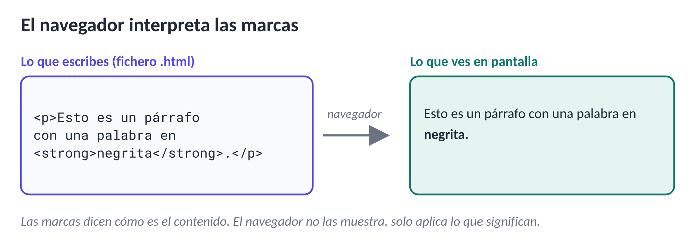
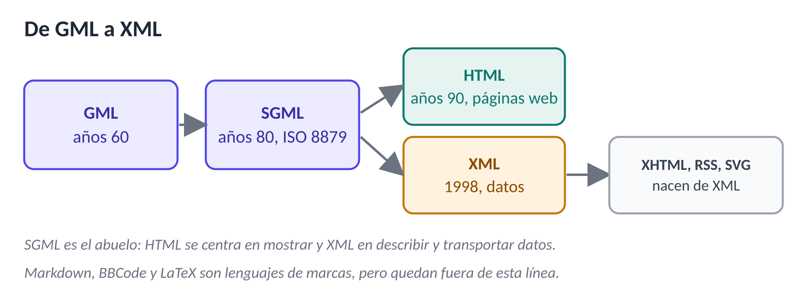
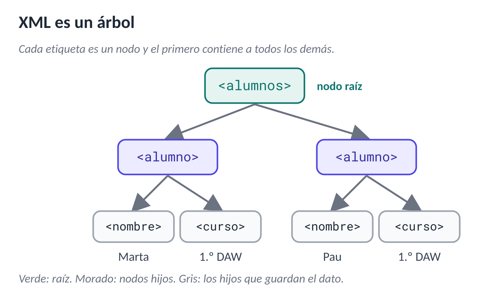
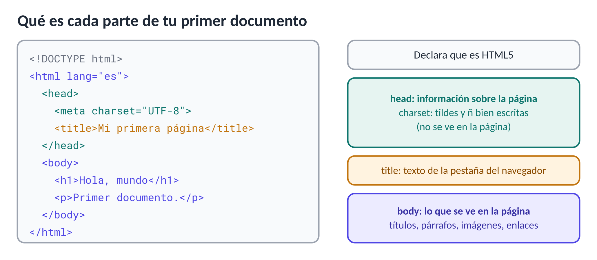

# Cómo usar este dosier {.nobreak}

Esta primera unidad de trabajo es la base de todo el módulo. Antes de escribir una sola página web conviene saber **qué es un lenguaje de marcas**, de dónde viene y para qué sirve cada uno de los más habituales. Al final de la unidad ya habrás escrito tu primer documento HTML y lo habrás abierto en el navegador.

Es un dosier para leer con un editor de texto abierto. Copia los ejemplos, cámbialos y mira qué pasa. Se aprende mucho más rompiendo un ejemplo que leyéndolo.

A lo largo del texto encontrarás cuatro tipos de caja:

!!! definicion "Definición"
    Un término que tienes que saber explicar con tus propias palabras.

!!! ejemplo "Ejemplo"
    Un caso concreto con su código.

!!! ojo "Ojo"
    Un error típico o una confusión frecuente.

!!! comprueba "Comprueba"
    Preguntas cortas al final de cada bloque. Si no sabes contestarlas sin mirar, vuelve a leer el bloque.

## Qué vas a aprender

Al terminar esta unidad deberías ser capaz de:

- **Explicar** qué es un lenguaje de marcas y qué tienen en común todos ellos.
- **Distinguir** un lenguaje de marcas de un lenguaje de programación.
- **Ordenar** en el tiempo GML, SGML, HTML y XML y decir qué aportó cada uno.
- **Reconocer** las marcas de XML, HTML, XHTML, BBCode, LaTeX, Markdown y SVG.
- **Elegir** el lenguaje adecuado para un caso concreto.
- **Crear** y abrir en el navegador un documento HTML con un editor de texto.

# Bloque 1. Qué es un lenguaje de marcas

## 1.1 Marcas y contenido

Cuando escribes en un procesador de textos, el programa guarda de forma interna dónde empieza un título, qué palabra va en negrita o dónde acaba un párrafo. Un lenguaje de marcas hace lo mismo, pero **a la vista**: esas indicaciones se escriben dentro del propio texto, con unos caracteres especiales.

!!! definicion "Lenguaje de marcas"
    Lenguaje que sirve para crear documentos que representan información, añadiendo al texto unas **marcas** (también llamadas **etiquetas**) que indican su estructura o su aspecto. Esa información se puede ver en un navegador, usar como fichero de configuración o intercambiar entre aplicaciones.

Las marcas se escriben con caracteres como `<`, `>` y `/`:

```html
<p>Esto es un párrafo con una palabra en <strong>negrita</strong>.</p>
```

El navegador no enseña las marcas: las interpreta y muestra solo el resultado, un párrafo con una palabra en negrita.

<figure></figure>

## 1.2 Características comunes

Todos los lenguajes de marcas comparten cuatro rasgos:

- **Texto plano.** Son ficheros de texto normal, sin formato oculto. Se pueden abrir y editar en cualquier editor, en cualquier sistema operativo.
- **Compactos.** Las marcas van mezcladas con el contenido, pero no aparecen en el resultado final.
- **De procesamiento ligero.** Crear un documento es fácil y las etiquetas se pueden combinar con otros lenguajes. Por ejemplo, HTML admite CSS y JavaScript dentro.
- **Flexibles.** Un sistema de etiquetas sirve para campos muy distintos: páginas web, libros, datos, fórmulas, dibujos.

## 1.3 No son lenguajes de programación

!!! ojo "Ojo"
    Un lenguaje de marcas **no es un lenguaje de programación**. No tiene variables, ni condiciones, ni bucles: no ejecuta nada, solo **describe** información. Quien la interpreta (el navegador, un conversor, otra aplicación) es quien hace algo con ella.

Por eso no se dice «programar en HTML», sino «escribir» o «maquetar» en HTML. La programación llegará más adelante con JavaScript.

!!! comprueba "Comprueba"
    1. ¿Qué diferencia hay entre una marca y el contenido?
    2. ¿Por qué se puede abrir un fichero HTML con el Bloc de notas?
    3. Nombra una cosa que pueda hacer un lenguaje de programación y no uno de marcas.

# Bloque 2. Un poco de historia

## 2.1 De GML a XML

Los lenguajes que usamos hoy vienen unos de otros. Esta es la línea principal:

| Año aprox. | Lenguaje | Qué aportó |
|---|---|---|
| Años 60 | **GML** (Generalized Markup Language) | Primer intento de estandarizar cómo se comparte información entre sistemas distintos. |
| Años 80 | **SGML** (Standard Generalized Markup Language) | Evolución de GML, norma ISO 8879. Muy potente, pero demasiado complejo para uso industrial. |
| Años 90 | **HTML** | Tim Berners-Lee simplifica SGML para poder ver información en los navegadores web. |
| 1998 | **XML** | Permite definir las etiquetas que uno quiera y resuelve las limitaciones de HTML. |


<figure></figure>

## 2.2 Qué se quedó de cada uno

SGML es el «abuelo»: HTML y XML nacieron de él, cada uno con un objetivo distinto. HTML se centra en **mostrar** páginas con un conjunto fijo de etiquetas. XML se centra en **describir y transportar** datos con etiquetas que define quien lo escribe.

!!! comprueba "Comprueba"
    1. ¿De qué lenguaje parten HTML y XML?
    2. ¿Por qué no se popularizó SGML en la industria?
    3. ¿Cuál de los dos, HTML o XML, permite inventar etiquetas propias?

# Bloque 3. Los lenguajes más habituales

## 3.1 Un vistazo rápido

| Lenguaje | Ejemplos de sus marcas | Para qué se usa |
|---|---|---|
| XML | `<persona>`, `<nombre>`, `</nombre>` | Datos y configuración |
| HTML | `<p>`, `<h1>`, `<a>`, `<strong>` | Páginas web |
| XHTML | `<html>`, `<body>`, `<p>` | HTML con las reglas estrictas de XML |
| BBCode | `[b]...[/b]`, `[url]...[/url]` | Foros y comentarios |
| LaTeX | `\section{...}`, `\textbf{...}`, `\frac{...}` | Documentos científicos |
| Markdown | `#`, `**...**`, `*...*`, `` `...` `` | Documentación técnica |
| SVG | `<svg>`, `<path>`, `<circle>` | Dibujos vectoriales |

Fíjate en que no todos usan `<` y `>`: BBCode usa corchetes, LaTeX usa barras invertidas y Markdown usa símbolos sueltos. Lo que los hace lenguajes de marcas es la idea, no los caracteres.

## 3.2 LaTeX

LaTeX se usa para escribir documentos científicos con calidad profesional.

- **Tipografía cuidada.** Controla con precisión el aspecto del documento, sobre todo en fórmulas matemáticas.
- **Numeración automática** de secciones, figuras, tablas y referencias bibliográficas.
- **Estándar académico.** Es el preferido en universidades y publicaciones científicas.

```latex
\section{Introducción}
Este texto tiene una parte en \textbf{negrita} y una fracción: $\frac{1}{2}$.
```

## 3.3 Markdown

Markdown es un lenguaje ligero para dar formato a un texto con muy pocos símbolos. Esta misma web está escrita en Markdown.

- **Sintaxis sencilla**, fácil de aprender y de escribir.
- **Se convierte** sin esfuerzo a HTML, PDF y otros formatos.
- **Muy extendido**: lo entienden GitHub, blogs, wikis y la mayoría de los editores.

```markdown
# Mi título

Un párrafo con **negrita**, *cursiva* y `código`.

- Primer elemento
- Segundo elemento
```

## 3.4 XML

XML (*eXtensible Markup Language*) permite crear etiquetas propias, adaptadas a cada proyecto.

- Es un **metalenguaje**: sirve para definir otros lenguajes, como XHTML, RSS o SVG.
- Su estructura es **jerárquica**: un árbol que empieza en un nodo raíz.
- Es un estándar de **intercambio** de datos entre sistemas.

```xml
<?xml version="1.0" encoding="UTF-8"?>
<alumnos>
  <alumno>
    <nombre>Marta</nombre>
    <curso>1.º DAW</curso>
  </alumno>
  <alumno>
    <nombre>Pau</nombre>
    <curso>1.º DAW</curso>
  </alumno>
</alumnos>
```

Aquí `<alumnos>` es la raíz y contiene dos nodos `<alumno>`, cada uno con sus hijos. Las etiquetas no existían de antemano: las hemos inventado nosotros.

<figure></figure>

## 3.5 HTML

HTML (*HyperText Markup Language*) es el estándar para crear páginas web. Combina texto, imágenes, enlaces y contenido multimedia.

- Estructura **semántica** clara.
- **Compatibilidad** universal: cualquier navegador lo entiende.
- **Evolución** constante: la versión actual es HTML5.
- Se integra con **CSS** (aspecto) y **JavaScript** (comportamiento).

```html
<h1>Mi primera página</h1>
<p>Esto es un párrafo con un <a href="https://www.santjosepobrer.es">enlace</a>.</p>
```

!!! ejemplo "Ejemplo"
    En HTML las etiquetas casi siempre van por parejas: una de apertura (`<p>`) y una de cierre (`</p>`), con el contenido en medio. Algunas, como `<br>` o ``, no tienen contenido y no se cierran.

!!! comprueba "Comprueba"
    1. ¿Qué significa que XML sea un «metalenguaje»?
    2. ¿Qué lenguaje de la tabla usarías para escribir un artículo con fórmulas matemáticas?
    3. Escribe en XML dos libros con título y autor.

# Bloque 4. Herramientas y primer documento

## 4.1 Editores

Un lenguaje de marcas es texto, así que basta cualquier editor de texto. Hay tres opciones habituales:

- **Bloc de notas.** Lo más básico. Hay que guardar el archivo con extensión `.html` para que el navegador lo abra como página web.
- **Notepad++.** Editor libre con coloreado de sintaxis y numeración de líneas, muy útil para localizar errores.
- **Visual Studio Code.** Editor de Microsoft con autocompletado, extensiones y servidor local para desarrollo. Es el que usaremos en clase.

!!! ojo "Ojo"
    Si guardas el archivo como `pagina.html.txt`, el navegador lo mostrará como texto y no como página. Comprueba siempre la extensión real, sobre todo en Windows, que suele ocultarla.

## 4.2 Tu primer documento HTML

Crea un archivo `index.html` con este contenido y ábrelo con doble clic:

```html
<!DOCTYPE html>
<html lang="es">
  <head>
    <meta charset="UTF-8">
    <title>Mi primera página</title>
  </head>
  <body>
    <h1>Hola, mundo</h1>
    <p>Este es mi primer documento escrito en un lenguaje de marcas.</p>
  </body>
</html>
```

<figure></figure>

!!! comprueba "Comprueba"
    Antes de abrirlo, predice qué verás en la pestaña del navegador y qué verás en la página. Después ábrelo y compara. ¿Dónde aparece el texto del `<title>`?

# Bloque 5. Elegir el lenguaje adecuado

Ningún lenguaje es el mejor en todo. Antes de empezar, piensa en cuatro cosas:

1. **El propósito.** ¿Es una página web, documentación, intercambio de datos o configuración?
2. **La audiencia.** ¿La van a leer desarrolladores, usuarios finales o programas?
3. **La complejidad.** ¿La estructura es sencilla o es un documento científico complejo?
4. **La compatibilidad.** ¿Qué herramientas y plataformas tienen que poder usarlo?

!!! ejemplo "Ejemplo"
    Un manual técnico para el equipo, que se versiona en GitHub, encaja con **Markdown**. Una lista de productos que otra aplicación debe leer encaja con **XML**. La web pública de la tienda, con **HTML**. Una tesis con muchas fórmulas, con **LaTeX**.

!!! comprueba "Comprueba"
    ¿Qué lenguaje elegirías para cada caso y por qué? a) Un foro de alumnos. b) Un logotipo que se vea nítido a cualquier tamaño. c) Un fichero de configuración que leen varios programas.

# Anexo A. Glosario

| Término | Significado |
|---|---|
| Marca o etiqueta | Elemento del lenguaje, como `<p>`, que indica la estructura o el aspecto del contenido. |
| Texto plano | Texto sin formato oculto, que se puede abrir con cualquier editor. |
| Metalenguaje | Lenguaje que sirve para definir otros lenguajes. |
| Nodo raíz | Elemento que contiene a todos los demás en un documento XML. |
| SGML | Lenguaje estándar (ISO 8879) del que descienden HTML y XML. |
| Navegador | Programa que interpreta HTML y muestra la página. |

# Anexo B. Mapa resumen

```text
GML  ->  SGML  ->  HTML (páginas web, años 90)
                \->  XML  (datos, 1998)  ->  XHTML, RSS, SVG
Fuera de esa línea: Markdown, BBCode, LaTeX
```

# Anexo C. Autoevaluación

## Preguntas cortas

1. Define «lenguaje de marcas» con tus palabras.
2. Cita tres características comunes a los lenguajes de marcas.
3. ¿Por qué HTML no es un lenguaje de programación?
4. Ordena de más antiguo a más reciente: XML, GML, HTML, SGML.

## Tipo test

1. ¿Cuál de estos es un metalenguaje?
    - a) HTML
    - b) XML
    - c) Markdown
    - d) BBCode
2. ¿Qué extensión debe tener un archivo para que el navegador lo abra como página web?
    - a) `.txt`
    - b) `.doc`
    - c) `.html`
    - d) `.xmlx`

## Razona

1. Una academia quiere publicar unos apuntes que se puedan convertir a web y a PDF y que cualquier profesor pueda editar sin formación. ¿Qué lenguaje les recomendarías y por qué?
