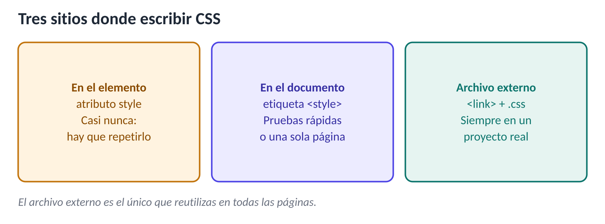
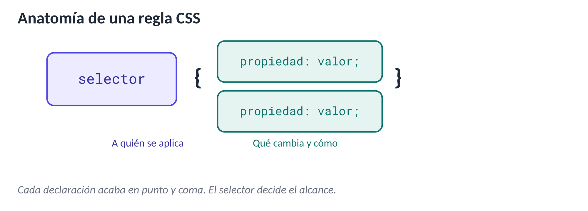
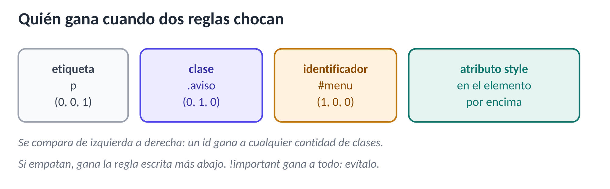
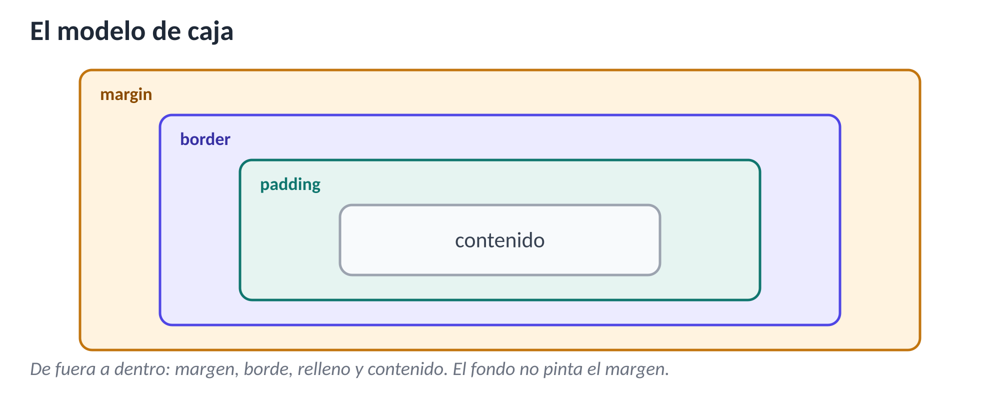
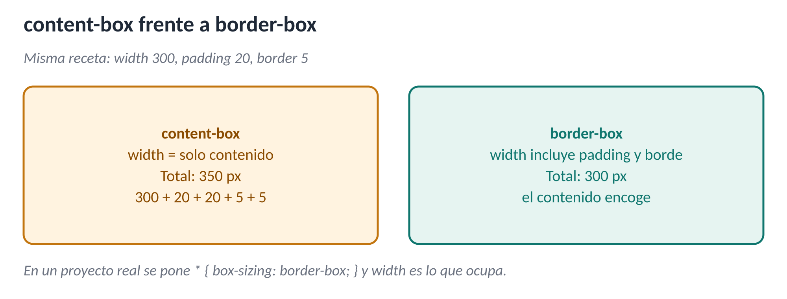
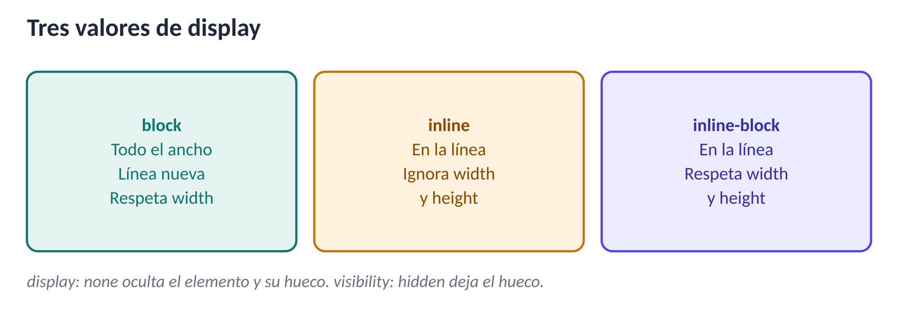

<!-- Notas del profesor: sesiones de 17/11 a 17/12. Acompañan las diapositivas «UT3. Presentación: Hojas de estilo CSS» y los ejercicios «UT3. Ejercicio: Selectores» y «UT3. Ejercicio: Modelo de caja». -->

# Cómo usar este dosier {.nobreak}

HTML dice **qué** es cada cosa de una página: un título, un párrafo, un enlace. CSS dice **cómo se ve**: el color, el tamaño de letra, el espacio alrededor, dónde se coloca. Esta unidad te enseña a controlar el aspecto de cualquier página que hayas escrito en la UT2.

Es un dosier para leer con el editor abierto y una página HTML cualquiera a mano. Copia cada ejemplo, cámbialo y mira qué pasa en el navegador. Para ver cómo se ha calculado el estilo de un elemento, pulsa F12 en el navegador y abre la pestaña «Elementos»: lo usarás en casi todos los bloques.

A lo largo del texto encontrarás estas cajas:

!!! definicion "Definición"
    Un término que tienes que saber explicar con tus propias palabras.

!!! ejemplo "Ejemplo"
    Un caso concreto con su código.

!!! ojo "Ojo"
    Un error típico o una confusión frecuente.

!!! predice "Predice"
    Una pregunta para pensar antes de seguir leyendo. Escribe tu respuesta y luego compruébala.

!!! comprueba "Comprueba"
    Preguntas o pruebas cortas al final de cada bloque. Si no sabes contestarlas sin mirar, vuelve a leer el bloque.

## Qué vas a aprender

Al terminar esta unidad deberías ser capaz de:

- **Explicar** para qué sirve CSS y por qué se separa del HTML.
- **Escribir** una regla CSS y enlazar una hoja de estilos externa.
- **Elegir** el selector más preciso para cada elemento.
- **Predecir** qué estilo gana cuando dos reglas chocan.
- **Dar formato** a texto, colores, fondos y enlaces.
- **Calcular** el tamaño real de una caja con margen, borde y relleno.
- **Controlar** cómo se muestra o se oculta un elemento con `display`, `visibility` y `overflow`.

## Índice

| Bloque | Contenido |
|---|---|
| [1](#bloque-1-que-es-css-y-como-se-escribe) | Qué es CSS y cómo se escribe |
| [2](#bloque-2-selectores) | Selectores |
| [3](#bloque-3-herencia-cascada-y-especificidad) | Herencia, cascada y especificidad |
| [4](#bloque-4-valores-colores-y-unidades) | Valores: colores y unidades |
| [5](#bloque-5-texto-fondos-y-enlaces) | Texto, fondos y enlaces |
| [6](#bloque-6-el-modelo-de-caja) | El modelo de caja |
| [7](#bloque-7-mostrar-ocultar-y-desbordar) | Mostrar, ocultar y desbordar |
| Anexos | Glosario, mapa resumen y autoevaluación |

# Bloque 1. Qué es CSS y cómo se escribe

## 1.1 Contenido y presentación

HTML y CSS se complementan. El HTML guarda el contenido y su estructura; el CSS guarda el aspecto. Si los separas, la misma página puede verse de formas distintas (en un móvil, en pantalla grande o impresa) sin tocar el contenido.

!!! definicion "CSS"
    CSS (Cascading Style Sheets, hojas de estilo en cascada) es el lenguaje que controla el aspecto visual de un documento HTML. Se escribe como una lista de reglas que dicen a qué elementos se aplica cada estilo.

CSS ha ido creciendo por versiones: CSS1 fue la primera oficial, CSS2 y CSS2.1 corrigieron errores y añadieron funciones, y CSS3 se divide en módulos que evolucionan por separado. Hoy se habla simplemente de «CSS» y el W3C mantiene cada módulo.

## 1.2 Tres sitios donde escribir CSS

Hay tres formas de aplicar estilos a un HTML.

<figure></figure>

**En el propio elemento**, con el atributo `style`:

```html
<p style="color: blue;">Texto azul</p>
```

**En el documento**, dentro de `<style>` en la cabecera:

```html
<head>
  <style>
    p { color: blue; }
  </style>
</head>
```

**En un archivo externo**, enlazado con `<link>`:

```html
<head>
  <link rel="stylesheet" href="estilos.css">
</head>
```

```css
/* estilos.css */
p { color: blue; }
```

| Forma | Dónde se escribe | Cuándo usarla |
|---|---|---|
| En el elemento | Atributo `style` | Casi nunca: hay que repetirlo etiqueta a etiqueta |
| En el documento | Etiqueta `<style>` | Pruebas rápidas o una sola página |
| Archivo externo | Archivo `.css` con `<link>` | Siempre en proyectos reales: un archivo estiliza todas las páginas |

!!! ojo "Ojo"
    Si el `<link>` no carga estilo alguno, casi siempre es la ruta de `href`. Revisa lo que aprendiste de rutas relativas en la UT2 y mira en F12 > Red si el archivo da error 404.

## 1.3 Anatomía de una regla

!!! definicion "Regla CSS"
    Una regla CSS tiene un **selector**, que indica a qué elementos se aplica, y un bloque entre llaves con una o varias **declaraciones**. Cada declaración es un par `propiedad: valor;`.

<figure></figure>

```css
selector {
  propiedad: valor;
  propiedad: valor;
}
```

```css
h1 {
  color: navy;
  font-size: 32px;
}
```

Los comentarios van entre `/*` y `*/` y pueden ocupar varias líneas. Úsalos para separar secciones del archivo.

!!! comprueba "Comprueba"
    1. Crea `estilos.css` con una regla que ponga todos los `<h1>` de color rojo y enlázalo desde un HTML. ¿Cambia el color?
    2. Quita el punto y coma de la primera declaración de una regla con dos. ¿Qué pasa con la segunda?
    3. ¿Qué ventaja tiene el archivo externo frente a `style` en cada etiqueta?

# Bloque 2. Selectores

El selector decide a qué elementos afecta una regla. Elegir bien el selector es la mitad de saber CSS.

## 2.1 Los tres básicos

| Selector | Se escribe | Elige |
|---|---|---|
| Etiqueta | `p` | Todos los elementos de esa etiqueta |
| Clase | `.destacado` | Todos los elementos con `class="destacado"` |
| Identificador | `#principal` | El elemento con `id="principal"` |

```html
<p>Un párrafo normal.</p>
<p class="destacado">Un párrafo destacado.</p>
<p id="principal">El párrafo principal.</p>
```

```css
p { color: gray; }
.destacado { background-color: yellow; }
#principal { font-size: 20px; }
```

!!! definicion "Clase e identificador"
    Una **clase** se puede repetir en tantos elementos como quieras, y un elemento puede llevar varias (`class="a b"`). Un **identificador** es único: solo puede haber un elemento con cada `id` en el documento.

El selector universal `*` elige todos los elementos de la página.

## 2.2 Combinar selectores

Los selectores se pueden combinar para ser más precisos.

| Selector | Ejemplo | Elige |
|---|---|---|
| Agrupación | `h1, h2` | Los elementos de cualquiera de los dos |
| Descendiente | `ul li` | Los `li` que están dentro de un `ul`, a cualquier profundidad |
| Hijo directo | `p > a` | Los `a` que son hijos inmediatos de un `p`, no los nietos |
| Hermano adyacente | `h2 + p` | El `p` que va justo después de un `h2` |
| Hermanos generales | `h2 ~ p` | Todos los `p` que van después de un `h2` en el mismo nivel |
| Clase y etiqueta | `p.premio` | Los `p` que además llevan la clase `premio` |

```css
.videojuego .genero { color: green; }   /* .genero dentro de .videojuego */
article h3 { color: purple; }           /* h3 dentro de article */
```

!!! ojo "Ojo"
    `.a .b` (con espacio) elige un `.b` dentro de un `.a`. `.a.b` (sin espacio) elige un elemento que tiene las dos clases a la vez. Un espacio cambia todo.

## 2.3 Selectores de atributo

Eligen elementos por un atributo de su etiqueta.

| Selector | Elige |
|---|---|
| `input[type="email"]` | Los `input` cuyo `type` es exactamente `email` |
| `a[href*="google"]` | Los enlaces cuyo `href` contiene «google» |
| `a[href^="https"]` | Los enlaces cuyo `href` empieza por «https» |
| `a[href$=".pdf"]` | Los enlaces cuyo `href` acaba en «.pdf» |

## 2.4 Pseudoclases y pseudoelementos

Una **pseudoclase** elige un elemento según su estado o posición, sin necesitar una clase. Se escribe con un dos puntos.

| Pseudoclase | Elige |
|---|---|
| `:first-child` | El primer hijo de su padre |
| `:last-child` | El último hijo |
| `:nth-child(3)` | El tercer hijo |
| `:nth-child(odd)` / `:nth-child(even)` | Los hijos impares o pares |
| `:hover` | Un elemento con el ratón encima |

Un **pseudoelemento** elige una parte de un elemento o crea contenido nuevo. Se escribe con dos puntos dobles.

```css
p::first-letter { font-size: 200%; color: orange; }
a::after { content: " ↗"; }
```

`::before` y `::after` insertan contenido antes o después del elemento y necesitan la propiedad `content`.

!!! predice "Predice"
    Tienes una lista de cinco `<li>` y esta regla: `li:nth-child(odd) { color: red; }`. ¿Qué elementos se ven en rojo? Pruébalo y comprueba si acertaste.

!!! comprueba "Comprueba"
    1. Escribe el selector más preciso para los `<h3>` que están dentro de un `<article>`.
    2. ¿Qué diferencia hay entre `p a` y `p > a`?
    3. Escribe un selector que elija los enlaces que acaban en `.pdf`.

# Bloque 3. Herencia, cascada y especificidad

## 3.1 Herencia

Muchas propiedades se transmiten de un elemento a sus hijos. Si pones `color: blue` a un `<div>`, los párrafos que tiene dentro también se ven azules, salvo que alguno tenga un estilo propio.

Se heredan casi siempre las propiedades de texto (`color`, `font-family`, `font-size`, `line-height`). No se heredan las de caja (`margin`, `padding`, `border`, `background`).

!!! ejemplo "Ejemplo"
    ```html
    <div class="padre">
      <p>Texto 1</p>
      <p class="especial">Texto 2</p>
    </div>
    ```
    ```css
    .padre { color: blue; }
    .especial { color: red; }
    ```
    «Texto 1» hereda el azul del padre. «Texto 2» tiene una regla propia y se ve rojo.

## 3.2 Cuando dos reglas chocan

Cuando varias reglas afectan al mismo elemento y a la misma propiedad, el navegador decide cuál gana con tres criterios, por este orden:

1. **Importancia.** Una declaración con `!important` gana a las demás. Evítalo: se queda como parche y complica todo lo demás.
2. **Especificidad.** Gana el selector más específico.
3. **Orden.** Si la especificidad es la misma, gana la regla que está escrita más abajo.

## 3.3 Calcular la especificidad

Imagina tres contadores, de mayor a menor peso: `(id, clase, etiqueta)`.

<figure></figure>

| Selector | Contador | Peso |
|---|---|---|
| `p` | (0, 0, 1) | Bajo |
| `.mensaje p` | (0, 1, 1) | Medio |
| `.mensaje .importante` | (0, 2, 0) | Mayor |
| `#importante` | (1, 0, 0) | El mayor de los tres |
| `style="…"` en el elemento | Por encima de todos | |
| `*` | (0, 0, 0) | El menor |

Se comparan de izquierda a derecha: un solo `id` pesa más que cualquier cantidad de clases.

!!! ejemplo "Ejemplo"
    ```css
    p { color: black; }
    .mensaje p { color: blue; }
    .mensaje .importante { color: red; }
    #importante { color: orange; }
    ```
    ```html
    <div class="mensaje">
      <p class="importante" id="importante">Hola</p>
    </div>
    ```
    El párrafo cumple las cuatro reglas. Gana `#importante`, con (1, 0, 0), así que el texto se ve naranja.

!!! predice "Predice"
    Dos reglas con el mismo selector `p`, una con `color: red;` y otra con `color: blue;`, escritas en ese orden. ¿De qué color se verá el párrafo? ¿Y si cambias el orden?

!!! ojo "Ojo"
    Si tu estilo «no funciona», no subas la especificidad a ciegas. Abre F12, mira el elemento y fíjate qué reglas aparecen tachadas: te dice quién le está ganando.

!!! comprueba "Comprueba"
    1. Calcula el contador de `ul li.activo` y de `#menu a`. ¿Cuál gana?
    2. Un `<li>` dentro de un `div` con `color: purple`, ¿de qué color se ve si el `li` no tiene regla propia? ¿Por qué?
    3. ¿Por qué no conviene usar `!important` en todas partes?

# Bloque 4. Valores: colores y unidades

## 4.1 Colores

CSS acepta varias formas de escribir un color.

| Formato | Ejemplo | Notas |
|---|---|---|
| Nombre | `red`, `teal` | Unos 140 nombres definidos |
| Hexadecimal | `#FF0000` | Pares RR, GG, BB |
| RGB | `rgb(255, 0, 0)` | Rojo, verde y azul de 0 a 255 |
| RGBA | `rgba(255, 0, 0, 0.5)` | Añade transparencia de 0 a 1 |
| HSL | `hsl(0, 100%, 50%)` | Matiz, saturación y luminosidad |

Para una web real conviene definir la paleta una sola vez con variables CSS y reutilizarla:

```css
:root {
  --color-principal: #0f766e;
}
h1 { color: var(--color-principal); }
```

## 4.2 Unidades absolutas y relativas

Las **absolutas** tienen un tamaño fijo: `px` (píxeles, la más usada), `cm`, `mm`, `in`, `pt`, `pc`. Las **relativas** dependen de otra medida:

| Unidad | Relativa a | Ejemplo |
|---|---|---|
| `%` | El elemento padre | `width: 50%` |
| `em` | El tamaño de letra del elemento padre | `font-size: 2em` |
| `rem` | El tamaño de letra de la raíz `html` (16 px por defecto) | `font-size: 1.5rem` |
| `vw` | 1 % del ancho de la ventana | `width: 90vw` |
| `vh` | 1 % del alto de la ventana | `height: 20vh` |

!!! ejemplo "Ejemplo"
    Un `<div>` con `font-size: 12px` contiene tres párrafos:

    | Párrafo | Valor | Tamaño final | Cálculo |
    |---|---|---|---|
    | A | `2em` | 24 px | 2 × 12 |
    | B | `1rem` | 16 px | Raíz (16 px) |
    | C | `150%` | 18 px | 1,5 × 12 |

!!! ojo "Ojo"
    El `em` se acumula: si anidas elementos con `1.2em`, cada nivel multiplica el anterior y la letra crece sin que lo esperes. `rem` no tiene ese problema porque siempre mira a la raíz. En la práctica se usan sobre todo `px`, `rem` y `%`.

!!! comprueba "Comprueba"
    1. ¿Cuántos píxeles mide un `font-size: 1.5rem` si no has tocado el de `html`?
    2. Escribe en CSS una caja que ocupe el 50 % del ancho del padre y otra que ocupe el 90 % del ancho de la ventana.
    3. ¿Por qué `rem` es más cómodo que `em` para tamaños de letra?

# Bloque 5. Texto, fondos y enlaces

## 5.1 Texto y fuentes

| Propiedad | Para qué sirve | Ejemplo |
|---|---|---|
| `color` | Color del texto | `color: #222;` |
| `font-family` | Tipo de letra, con alternativas | `font-family: "Segoe UI", Arial, sans-serif;` |
| `font-size` | Tamaño | `font-size: 1.125rem;` |
| `font-style` | Cursiva | `font-style: italic;` |
| `text-align` | Alineación | `text-align: center;` |
| `text-decoration` | Subrayado | `text-decoration: none;` |
| `text-transform` | Mayúsculas o minúsculas | `text-transform: uppercase;` |

En `font-family` se escribe una lista de alternativas separadas por comas. El navegador usa la primera que tenga instalada. Termina siempre con una **familia genérica** (`serif`, `sans-serif`, `monospace`) por si no hay ninguna de las anteriores. Los nombres con espacios van entre comillas.

## 5.2 Fondos

| Propiedad | Para qué sirve |
|---|---|
| `background-color` | Color de fondo |
| `background-image` | Imagen de fondo: `url("fondo.png")` |
| `background-repeat` | `repeat` (por defecto), `repeat-x`, `repeat-y` o `no-repeat` |
| `background-position` | Dónde se coloca: `right top`, `center` |
| `background-size` | `cover` para cubrir toda la caja, `contain` para que quepa entera |

Con `background` se pueden escribir varias a la vez:

```css
body {
  background: #ffffff url("arbol.png") no-repeat right top;
}
```

## 5.3 Enlaces

Un enlace tiene cuatro estados, y cada uno se estiliza con su pseudoclase.

```css
a:link    { color: #0f766e; }   /* sin visitar */
a:visited { color: #6d28d9; }   /* visitado */
a:hover   { color: #c2750f; text-decoration: underline; }   /* ratón encima */
a:active  { color: #b91c1c; }   /* mientras se pulsa */
```

!!! ojo "Ojo"
    El orden importa: `:hover` va después de `:link` y `:visited`, y `:active` después de `:hover`. Si los cambias, algunos estados dejan de verse.

!!! comprueba "Comprueba"
    1. Escribe un `font-family` con una fuente concreta y una genérica de reserva.
    2. Haz que los enlaces no estén subrayados salvo cuando pasas el ratón por encima.
    3. ¿Qué diferencia hay entre `background-size: cover` y `contain`?

# Bloque 6. El modelo de caja

## 6.1 Todo elemento es una caja

!!! definicion "Modelo de caja"
    Cada elemento HTML se dibuja como una caja con cuatro capas, de dentro hacia fuera: el **contenido**, el **relleno** (`padding`, espacio entre el contenido y el borde), el **borde** (`border`) y el **margen** (`margin`, espacio exterior que separa la caja de las demás).

<figure></figure>

```css
.caja {
  width: 300px;
  padding: 20px;
  border: 5px solid black;
  margin: 10px;
}
```

El fondo (`background`) se pinta detrás del contenido y del relleno, pero no del margen.

Los atajos de `margin` y `padding` aceptan uno a cuatro valores:

| Escritura | Significado |
|---|---|
| `margin: 10px` | Los cuatro lados |
| `margin: 10px 20px` | Arriba y abajo 10, izquierda y derecha 20 |
| `margin: 10px 20px 5px 0` | Arriba, derecha, abajo, izquierda (el sentido del reloj) |
| `margin: 0 auto` | Sin margen vertical y centrada horizontalmente (si tiene `width`) |

## 6.2 Tamaño de las cajas

`width` y `height` dan el ancho y el alto. `max-width` y `min-width` ponen límites: la caja crece o se encoge dentro de ese rango. Con `auto`, el navegador calcula el tamaño según el contenido.

```css
.recuadro {
  width: 50%;
  max-width: 400px;
  min-width: 200px;
}
```

## 6.3 `box-sizing`: cuánto ocupa una caja de verdad

Por defecto (`content-box`), `width` mide solo el contenido, y el padding y el borde se suman por fuera. Con `border-box`, `width` incluye contenido, relleno y borde.

!!! predice "Predice"
    Una caja tiene `width: 300px; padding: 20px; border: 5px solid black;`. ¿Cuántos píxeles ocupa en horizontal con `content-box`? ¿Y con `border-box`? Mídelo en F12 antes de seguir.

Con `content-box`: 300 + 20 + 20 + 5 + 5 = **350 px**. Con `border-box`: **300 px**.

<figure></figure>

Muchos proyectos aplican `border-box` a todo para evitar sorpresas:

```css
* { box-sizing: border-box; }
```

!!! ojo "Ojo"
    Los márgenes verticales de dos cajas seguidas se solapan: si una tiene `margin-bottom: 20px` y la siguiente `margin-top: 30px`, la separación es de 30 px, no de 50.

!!! comprueba "Comprueba"
    1. Calcula el ancho total de una caja con `width: 200px; padding: 10px; border: 2px solid; box-sizing: content-box;`.
    2. ¿Cómo centras horizontalmente una caja de ancho fijo?
    3. ¿Qué cambia en el ancho total si añades `box-sizing: border-box` al caso 1?

# Bloque 7. Mostrar, ocultar y desbordar

## 7.1 `display`

`display` define qué tipo de caja es un elemento.

<figure></figure>

| Valor | Comportamiento |
|---|---|
| `block` | Ocupa todo el ancho y empieza en línea nueva. Respeta `width`, `height` y márgenes |
| `inline` | Se coloca en la línea con el texto. Ignora `width` y `height` |
| `inline-block` | Va en línea, pero respeta `width` y `height` |
| `none` | El elemento desaparece y no ocupa sitio |

Los `<p>`, `<div>` y `<h1>` son de tipo `block` por defecto; `<span>` y `<a>`, `inline`. Más adelante verás `flex` y `grid`, que son los valores con los que se colocan las cajas en la UT4.

## 7.2 `visibility`

`visibility: hidden` oculta el elemento pero **deja su hueco**. Con `display: none` el hueco desaparece también.

!!! predice "Predice"
    Tienes un `<h1>`, un `<h2>` y un `<h3>` seguidos y aplicas `visibility: hidden` al `<h2>`. ¿Se mueve el `<h3>` hacia arriba? ¿Y con `display: none`?

## 7.3 `overflow`

Cuando el contenido no cabe en la caja, `overflow` decide qué pasa.

| Valor | Efecto |
|---|---|
| `visible` | El contenido se sale por fuera (por defecto) |
| `hidden` | Se oculta lo que no cabe |
| `scroll` | Barras de desplazamiento siempre |
| `auto` | Barras solo si hacen falta |

!!! comprueba "Comprueba"
    1. Crea tres `<span>` con `padding: 10px` y borde. ¿Se respeta el relleno vertical en `inline`? ¿Y en `inline-block`?
    2. Un `div` de 100 × 100 px con un texto largo: pruébalo con los cuatro valores de `overflow` y anota la diferencia.

# Anexo A. Glosario

| Término | Significado |
|---|---|
| Regla | Selector más un bloque de declaraciones |
| Declaración | Pareja `propiedad: valor;` |
| Selector | Parte de la regla que dice a qué elementos se aplica |
| Clase | Nombre reutilizable que se asigna con `class` y se elige con `.` |
| Identificador | Nombre único que se asigna con `id` y se elige con `#` |
| Pseudoclase | Selector por estado o posición, como `:hover` |
| Pseudoelemento | Selector de una parte o contenido creado, como `::before` |
| Herencia | Transmisión de un valor del padre a sus hijos |
| Especificidad | Peso de un selector para decidir qué regla gana |
| Modelo de caja | Contenido, relleno, borde y margen de cada elemento |
| `rem` | Unidad relativa al tamaño de letra de la raíz |

# Anexo B. Mapa resumen

```text
Regla CSS = selector { propiedad: valor; }

Quién gana:  !important  >  especificidad (id > clase > etiqueta)  >  orden
Caja:        margin > border > padding > contenido
Tamaño:      content-box suma padding y borde, border-box los incluye
Visible:     display: none (sin hueco)   visibility: hidden (con hueco)
```

# Anexo C. Autoevaluación

## Preguntas cortas

1. ¿Qué ventaja tiene separar HTML y CSS?
2. Enumera las tres formas de incluir CSS en un HTML y di cuál se recomienda.
3. ¿Cuál es la diferencia entre un `id` y una clase?
4. ¿Qué elige `ul > li`? ¿Y `h2 + p`?
5. ¿Qué propiedades se heredan normalmente y cuáles no?

## Tipo test

1. ¿Qué selector tiene más especificidad?
    - a) `p`
    - b) `.aviso`
    - c) `#aviso`
    - d) `p.aviso`
2. Con `box-sizing: content-box`, ¿cuánto ocupa horizontalmente una caja con `width: 200px; padding: 10px; border: 5px solid;`?
    - a) 200 px
    - b) 210 px
    - c) 220 px
    - d) 230 px
3. ¿Qué hace `visibility: hidden`?
    - a) Elimina el elemento y su hueco
    - b) Oculta el elemento pero conserva su hueco
    - c) Lo hace transparente al 50 %
    - d) Lo saca de la página
4. Un `div` con `font-size: 20px` contiene un párrafo con `font-size: 1.5em`. ¿Cuánto mide la letra del párrafo?
    - a) 15 px
    - b) 20 px
    - c) 30 px
    - d) 24 px

## Razona

1. Un compañero dice que su estilo `p { color: red; }` «no funciona» porque el texto sigue azul. Explica tres causas posibles y cómo comprobarías cada una con F12.
